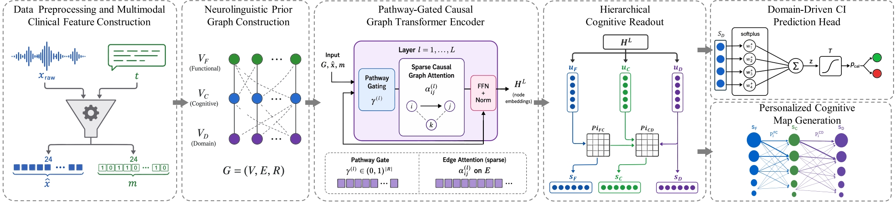

# SpeechCGT

## Abstract

SpeechCGT addresses a common limitation in speech-based dementia screening: many existing models predict impairment accurately but provide little clinically meaningful explanation. In SpeechCGT, subject-level audio and aligned transcripts are converted into a fixed 24-dimensional clinical feature set spanning prosodic, phonatory, temporal, lexical, syntactic, semantic, and discourse cues. These features are injected into a fixed neurolinguistic graph with 24 speech-feature nodes, 10 cognitive-function nodes, and 4 cognitive-domain nodes. The core model is a Pathway-Gated Causal Graph Transformer encoder that performs sparse relational attention only over clinically valid edges. Patient-specific gating personalizes the strength of allowed pathways while preserving the shared prior graph. A hierarchical readout then produces feature salience, cognitive-function impairment scores, cognitive-domain impairment scores, and ranked feature-to-function and function-to-domain pathways before making the final `CN/CI` prediction. The result is an interpretable framework for speech-based cognitive impairment detection that aims to preserve both predictive utility and pathway-level transparency.




Figure 1: SpeechCGT framework overview showing the multimodal feature extraction pipeline, fixed neurolinguistic graph, pathway-gated causal graph transformer, and interpretable CN/CI prediction readout.

## Datasets

SpeechCGT is designed for the DementiaBank Cookie Theft task and uses the following corpora:

- Pitt Corpus: https://talkbank.org/dementia/access/English/Pitt.html
- Delaware Corpus: https://talkbank.org/dementia/access/English/Protocol/Delaware.html
- WLS Corpus: https://talkbank.org/dementia/access/English/WLS.html

Notes:

- Please follow TalkBank/DementiaBank access and usage requirements.
- In the SpeechCGT protocol, `WLS` is used only as a fully held-out external generalization set.
- The codebase supports both normalized manifests and raw-corpus adapters that export manifests.

## Requirements

### Libraries

- Python `3.11`
- `torch >= 2.2`
- `torch-geometric >= 2.5`
- `numpy >= 1.26`
- `pandas >= 2.2`
- `PyYAML >= 6.0`
- `scikit-learn >= 1.4`
- `soundfile >= 0.12`
- `librosa >= 0.10`
- `pyloudnorm >= 0.1.1`
- `praat-parselmouth >= 0.4.4`
- `spacy >= 3.7`
- `stanza >= 1.8`
- `pytest >= 8.2` for tests

### Tools

- `git`
- A compatible PyTorch / PyG installation for your CPU or CUDA environment
- Optional NVIDIA GPU for training
- Access to the DementiaBank/TalkBank datasets

## Installation

From the repository root:

```bash
python -m venv .venv
```

Activate the environment:

- Windows PowerShell: `.\.venv\Scripts\Activate.ps1`
- Linux/macOS: `source .venv/bin/activate`

Install the package and development dependencies:

```bash
pip install --upgrade pip
pip install -e ./speechcgt[dev]
python -m spacy download en_core_web_sm
python -c "import stanza; stanza.download('en')"
```

If you need a specific CUDA build of PyTorch or PyG, install those compatible wheels first, then run `pip install -e ./speechcgt[dev]`.

## How To Run

### 1. Prepare data

SpeechCGT expects either:

- normalized manifests named `pitt.csv`, `delaware.csv`, and optionally `wls.csv` in `speechcgt/data/manifests/`, or
- raw corpus locations plus metadata configured in `speechcgt/configs/default.yaml`

Normalized manifest columns should be:

```text
sample_id, participant_id, audio_path, transcript, label, corpus_id, corpus_name
```

If you want the repository to build manifests from raw corpora, edit the adapter paths in `speechcgt/configs/default.yaml`, then run:

```bash
speechcgt-build-manifests --config speechcgt/configs/default.yaml
```

### 2. Train the model

Train on Pitt as the source corpus:

```bash
speechcgt-train --config speechcgt/configs/pitt.yaml
```

Train on Delaware as the source corpus:

```bash
speechcgt-train --config speechcgt/configs/delaware.yaml
```

Train only one fold:

```bash
speechcgt-train --config speechcgt/configs/pitt.yaml --fold 0
```

Training outputs are written under `outputs/speechcgt/` by default.

### 3. Evaluate a checkpoint

```bash
speechcgt-evaluate \
  --checkpoint outputs/speechcgt/fold_0/checkpoint.pt \
  --manifest speechcgt/data/manifests/pitt.csv
```

### 4. Run inference on one sample

```bash
speechcgt-infer \
  --checkpoint outputs/speechcgt/fold_0/checkpoint.pt \
  --audio-path path/to/sample.wav \
  --transcript-path path/to/sample.cha \
  --sample-id sample_001 \
  --participant-id participant_001 \
  --corpus-name Pitt \
  --output outputs/speechcgt/sample_001_report.json
```

You can also pass `--transcript "..."` directly instead of `--transcript-path`.

### 5. Run tests

```bash
pytest speechcgt/tests -q
```

## Repository Notes

- The implementation follows the fixed SpeechCGT hierarchy described in `02-SpeechCGT-Proposed-Framework.md`.
- The current feature extraction layer uses deterministic best-effort heuristics consistent with the framework specification and explicit missingness handling.
- Calibration affects only the reported probability and thresholded label. Cognitive map tensors and ranked pathways are not recalibrated.

## Citation

If this repository contributes to your research, please cite the SpeechCGT paper.

Title:

`SpeechCGT: A Knowledge-Guided Causal Graph Transformer for Interpretable Cognitive Impairment Detection from Multimodal Speech`

If the final bibliographic metadata is not yet available, you can keep a placeholder like this and replace it with the published record later:

```bibtex
@misc{speechcgt,
  title = {SpeechCGT: A Knowledge-Guided Causal Graph Transformer for Interpretable Cognitive Impairment Detection from Multimodal Speech},
  author = {Author(s)},
  year = {2026},
  note = {Manuscript / preprint metadata to be updated}
}
```

